# BdSL Vision

Bangla Sign Language Sentence Recognition with browser webcam capture, FastAPI, MediaPipe Tasks, PyTorch Model 6, and word-level CTC decoding.

BdSL Vision is designed for the correct workflow:

```text
Start -> sign one complete sentence -> Stop -> upload finished clip -> extract landmarks -> Model 6 -> CTC decode -> Bangla sentence
```

This is continuous sentence recognition using word-level CTC decoding. It is not causal streaming recognition.

## Architecture

```mermaid
flowchart LR
  A["Browser webcam preview"] --> B["MediaRecorder completed clip"]
  B --> C["FastAPI multipart upload"]
  C --> D["OpenCV video decode"]
  D --> E["MediaPipe VIDEO landmark extraction"]
  E --> F["[T, 1662] sequence"]
  F --> G["25 FPS resampling, max 384 frames"]
  G --> H["Model 6"]
  H --> I["Greedy word-level CTC"]
  I --> J["Bangla sentence + diagnostics"]
```



## Requirements

- Python 3.10, 3.11, or 3.12 recommended. MediaPipe and PyTorch wheels may not be available for every Python 3.13 environment.
- Node.js 20+.
- A browser with `getUserMedia` and `MediaRecorder`.
- The supplied Model 6 files:
  - `backend/models/model6_best_wer_checkpoint.pt`
  - `backend/models/bangla_vocab_tsv_fixed.json`

## Project Structure

```text
backend/
  app/
    api/
    model/
    services/
    utils/
    main.py
    config.py
    schemas.py
  assets/mediapipe/
  models/
  scripts/download_mediapipe_models.py
  tests/
frontend/
  src/
    components/
    features/
    hooks/
    lib/
    pages/
    styles/
scripts/
docs/
```

## Setup

### Backend

```bash
cd backend
python -m venv .venv
```

Windows:

```bat
.venv\Scripts\activate
pip install -r requirements.txt
python scripts\download_mediapipe_models.py
python -m uvicorn app.main:app --host 127.0.0.1 --port 8000 --reload
```

Linux/macOS:

```bash
source .venv/bin/activate
pip install -r requirements.txt
python scripts/download_mediapipe_models.py
python -m uvicorn app.main:app --host 127.0.0.1 --port 8000 --reload
```

### Frontend

```bash
cd frontend
npm install
npm run dev
```

Frontend URL: `http://127.0.0.1:5173`

Backend URL: `http://127.0.0.1:8000`

### Run Both

Windows:

```bat
scripts\run_dev.bat
```

Linux/macOS:

```bash
chmod +x scripts/run_dev.sh
./scripts/run_dev.sh
```

## Configuration

Copy `backend/.env.example` and `frontend/.env.example` if you need overrides.

Important backend settings:

- `MODEL_CHECKPOINT_PATH`
- `VOCAB_PATH`
- `MEDIAPIPE_ASSET_DIR`
- `MAX_UPLOAD_MB`
- `MAX_VIDEO_SECONDS`
- `CORS_ORIGINS`
- `HOST`
- `PORT`

Frontend:

- `VITE_API_BASE_URL`

When `VITE_API_BASE_URL` is empty, Vite proxies `/api` to `http://127.0.0.1:8000`.

## API

- `GET /api/health`
- `GET /api/model/info`
- `POST /api/inference/video`
- `GET /api/history`
- `DELETE /api/history`
- `DELETE /api/history/{id}`

`POST /api/inference/video` accepts multipart form data with field name `file`.

## Model Contract

- Input shape: `[T, 1662]`
- Feature order: pose, face, left hand, right hand
- Pose: `33 x 4 = 132`
- Face: `468 x 3 = 1404`
- Left hand: `21 x 3 = 63`
- Right hand: `21 x 3 = 63`
- Target FPS: 25
- Max sequence length: 384 frames
- Output temporal length: `floor((T - 1) / 2) + 1`
- Expected parameter count with vocab size 39: `4,924,163`
- Expected blank index: `0`
- EMA checkpoint state is preferred when present.

## Tests

Backend:

```bash
cd backend
pytest
```

Frontend:

```bash
cd frontend
npm test
npm run build
```

Some backend tests require PyTorch, OpenCV, MediaPipe, FastAPI, and the model files.

## Camera Notes

- Browser preview may be visually mirrored with CSS.
- The recorded video is not flipped before upload.
- Audio is not requested.
- Camera tracks are stopped when switching devices or leaving the recognition page.

## Privacy

Default behavior:

- Camera preview stays in the browser.
- The completed recording is uploaded only after Stop.
- The backend processes it for inference.
- Temporary video files are deleted in a `finally` block after inference.
- Raw video is not saved by default.
- History stores structured prediction metadata only.

## CUDA Notes

The backend uses CUDA when PyTorch reports it is available. CUDA autocast is enabled only on CUDA and the model's `log_softmax` remains FP32.

## Troubleshooting

- Backend unavailable: check `http://127.0.0.1:8000/api/health`.
- Model not ready: verify checkpoint and vocabulary paths.
- MediaPipe startup failure: run `python backend/scripts/download_mediapipe_models.py`.
- Camera denied: reset browser site permissions and reload.
- Unsupported video: use Chrome or Edge with WebM MediaRecorder support.
- Too short: record one complete sentence longer than the configured minimum.
- Sequence too long: keep one sentence under about 15 seconds.

## Known Limitations

Model 6 is a full-sequence/non-causal encoder. The final sentence is generated after the user finishes the sign sequence.

The confidence value is an uncalibrated greedy-decoding heuristic, not a calibrated probability.

