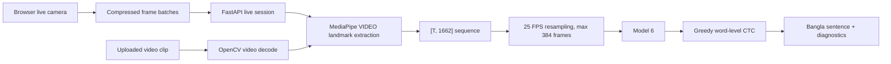

# BdSL Vision

Bangla Sign Language Sentence Recognition with live browser camera translation, uploaded video inference, FastAPI, MediaPipe Tasks, PyTorch Model 6, and word-level CTC decoding.

[Code license: MIT](LICENSE) · [Evaluation](docs/EVALUATION.md) · [Model card](docs/MODEL_CARD.md) · [Contributing](CONTRIBUTING.md) · [Maintainers](MAINTAINERS.md)

This is a research prototype for camera-based BdSL accessibility experiments.
The repository implements **1662D Model 6 (4,924,163 parameters)**. The final-year
report's proposed model uses **646D features (4,129,350 parameters)**; its reported
2.851% held-out test WER is not a verified score for the checkpoint in this repo.
See the [evaluation guide](docs/EVALUATION.md) for attributed research results,
reproducible measurement tools and remaining evidence gaps. Code is MIT licensed;
model, vocabulary, dataset and third-party asset rights are tracked separately
in [NOTICE.md](NOTICE.md).

BdSL Vision is designed for the correct workflow:

```text
Live camera -> stream latest frame batches -> accumulate landmarks in a backend session -> final Model 6 CTC decode -> Bangla sentence
Video upload -> decode completed clip -> extract landmarks -> Model 6 -> CTC decode -> Bangla sentence
```

The live camera path keeps a rolling in-memory landmark session and drops stale browser-frame backlog, so delayed backend work does not replay old signs. Model 6 is still a full-sequence encoder, so the live page prioritizes fast final decoding after sentence-end detection instead of continuously publishing stale partial drafts.

Live camera recognition uses a pre-Model 6 segmentation layer:

```text
IDLE -> motion threshold for consecutive frames -> SIGNING
SIGNING -> low motion for about 0.9s -> FINALIZING
FINALIZING -> Model 6 + CTC -> RESULT -> ready for next sign
```

The motion score weights hand movement most heavily, then wrist/arm movement, then lower-weight body movement. Model 6 is not changed.
Idle landmark jitter is treated as background noise: the backend requires repeated hand motion, enough active frames, and minimum average motion before it runs Model 6 for a live draft or final sentence.

## Architecture



## Requirements

- Python 3.10, 3.11, or 3.12 recommended. MediaPipe and PyTorch wheels may not be available for every Python 3.13 environment.
- Node.js 22.12+ recommended for the locked frontend toolchain.
- A browser with `getUserMedia`.
- The supplied Model 6 files:
  - `backend/models/model6_best_wer_checkpoint.pt`
  - `backend/models/bangla_vocab_tsv_fixed.json`

## Project Structure

```text
backend/
  app/
    api/
    model/
    services/
    utils/
    main.py
    config.py
    schemas.py
  assets/mediapipe/
  models/
  scripts/download_mediapipe_models.py
  tests/
frontend/
  src/
    components/
    features/
    hooks/
    lib/
    pages/
    styles/
scripts/
docs/
```

## Setup

### Backend

```bash
cd backend
python -m venv .venv
```

Windows:

```bat
.venv\Scripts\activate
pip install -r requirements.txt
python scripts\download_mediapipe_models.py
python -m uvicorn app.main:app --host 127.0.0.1 --port 8000 --reload
```

Linux/macOS:

On Debian/Ubuntu, install MediaPipe's native graphics libraries first (also
required on a headless server):

```bash
sudo apt-get update
sudo apt-get install --yes libegl1 libgl1
```

```bash
source .venv/bin/activate
pip install -r requirements.txt
python scripts/download_mediapipe_models.py
python -m uvicorn app.main:app --host 127.0.0.1 --port 8000 --reload
```

### Frontend

```bash
cd frontend
npm ci
npm run dev
```

Frontend URL: `http://127.0.0.1:5173`

Backend URL: `http://127.0.0.1:8000`

### Run Both

Windows:

```bat
scripts\run_dev.bat
```

Linux/macOS:

```bash
chmod +x scripts/run_dev.sh
./scripts/run_dev.sh
```

## Configuration

Copy `backend/.env.example` and `frontend/.env.example` if you need overrides.

Important backend settings:

- `MODEL_CHECKPOINT_PATH`
- `VOCAB_PATH`
- `MEDIAPIPE_ASSET_DIR`
- `INFERENCE_ARTIFACT_DIR`
- `MAX_UPLOAD_MB`
- `MAX_VIDEO_SECONDS`
- `CORS_ORIGINS`
- `HOST`
- `PORT`
- `SAVE_INFERENCE_ARTIFACTS=true` writes upload/live final raw landmark and 25 FPS feature arrays for A/B debugging.

Frontend:

- `VITE_API_BASE_URL`

When `VITE_API_BASE_URL` is empty, Vite proxies `/api` to `http://127.0.0.1:8000`.

## API

- `GET /api/health`
- `GET /api/model/info`
- `POST /api/inference/video`
- `POST /api/inference/frames`
- `POST /api/inference/live`
- `GET /api/history`
- `DELETE /api/history`
- `DELETE /api/history/{id}`

`POST /api/inference/video` accepts multipart form data with field name `file`. Optional form field `save_history=false` skips history writes.

`POST /api/inference/live` accepts JSON frame batches with an optional `session_id`. It returns the live session id even when the current partial is too short to decode, allowing the frontend to keep accumulating landmarks instead of restarting.
The live response also reports current `capture_fps` and pose/hand detection rates so webcam preprocessing quality can be compared with uploaded video diagnostics.
The Live page records the same camera stream during a session; after pausing, use **Download Clip** and submit that file on the Upload page to compare the exact webcam recording against the live `[T,1662]` path.

## Model Contract

- Input shape: `[T, 1662]`
- Feature order: pose, face, left hand, right hand
- Pose: `33 x 4 = 132`
- Face: `468 x 3 = 1404`
- Left hand: `21 x 3 = 63`
- Right hand: `21 x 3 = 63`
- Target FPS: 25
- Max sequence length: 384 frames
- Output temporal length: `floor((T - 1) / 2) + 1`
- Expected parameter count with vocab size 39: `4,924,163`
- Expected blank index: `0`
- EMA checkpoint state is preferred when present.

## Tests

Backend:

```bash
cd backend
pytest
```

Frontend:

```bash
cd frontend
npm test
npm run build
```

Some backend tests require PyTorch, OpenCV, MediaPipe, FastAPI, and the model files.

## Camera Notes

- Browser preview may be visually mirrored with CSS.
- Live camera translation sends compressed video frames to the configured backend API.
- Audio is not requested.
- Camera tracks are stopped when switching devices or leaving the recognition page.

## Privacy

Default behavior:

- Live camera sends compressed frame batches only while the camera is on.
- Uploaded video clips are processed for inference.
- Temporary video files are deleted in a `finally` block after inference.
- Raw video is not saved by default.
- History stores structured prediction metadata only.

## CUDA Notes

The backend uses CUDA when PyTorch reports it is available. CUDA autocast is enabled only on CUDA and the model's `log_softmax` remains FP32.

## Troubleshooting

- Backend unavailable: check `http://127.0.0.1:8000/api/health`.
- Model not ready: verify checkpoint and vocabulary paths.
- MediaPipe startup failure: run `python backend/scripts/download_mediapipe_models.py`.
- Camera denied: reset browser site permissions and reload.
- Unsupported video: use Chrome or Edge with WebM MediaRecorder support.
- Too short: provide one complete sentence longer than the configured minimum.
- Sequence too long: keep one sentence under about 15 seconds.

## Known Limitations

Model 6 is a full-sequence/non-causal encoder. Live camera output is finalized after sentence-end detection; uploaded videos and clean live windows usually provide the most stable sentence.

The confidence value is an uncalibrated greedy-decoding heuristic, not a calibrated probability.

Recognition is limited to the bundled vocabulary. Current-checkpoint WER,
real labeled examples, signer-independent performance and full browser/live
latency remain unverified. Synthetic latency tests measure execution cost only.

## Evaluation and contributions

From the repository root, with backend dependencies installed:

```bash
python backend/scripts/benchmark_model.py --frames 128 384 --warmup 5 --runs 30 --threads 1 --output evaluation-results/model6-latency.json
```

For real predictions and corpus WER, follow the labeled-video protocol in
[docs/EVALUATION.md](docs/EVALUATION.md). Do not publish private recordings or
reuse the report's scores for a different checkpoint.

See [CONTRIBUTING.md](CONTRIBUTING.md) for checks and pull requests,
[MAINTAINERS.md](MAINTAINERS.md) for stewardship,
[the roadmap](docs/ROADMAP.md) for evidence gaps, and
[the changelog](CHANGELOG.md) for changes. Bug reports and evaluation proposals
can be submitted through [GitHub issues](https://github.com/Rajibkd1/Sign_language_real_time_prediction/issues/new/choose).
