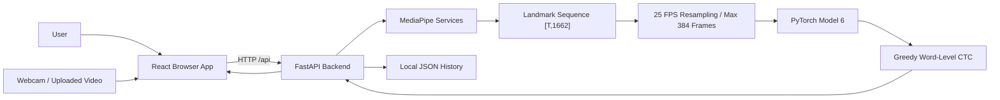

# BdSL Vision Project Architecture

## 1. Executive Summary

BdSL Vision is a local web application for Bangla Sign Language sentence recognition. It combines a React/Vite browser interface with a FastAPI backend that runs MediaPipe landmark extraction and a PyTorch Model 6 sequence recognizer.

The system supports two main user workflows:

1. Live camera recognition: the browser captures webcam frames, sends compressed frame batches to the backend, and the backend maintains an in-memory live session until signing motion ends.
2. Video upload recognition: the browser uploads a completed video clip, the backend decodes the video, extracts landmarks, runs Model 6, and returns a Bangla sentence with diagnostics.

The important architectural point is that Model 6 is not a frame-by-frame causal model. It is a full-sequence model that expects a complete or meaningful landmark sequence. The live system therefore adds a segmentation layer around the model: motion starts a segment, silence finalizes it, and Model 6 decodes the resulting sequence.

## 2. Repository Layout

```text
BdSL/
  README.md
  Model6_Local_Live_Webcam_v4.0.py
  model6_best_wer_checkpoint.pt
  bangla_vocab_tsv_fixed.json
  backend/
    .env.example
    requirements.txt
    app/
      main.py
      main_cli.py
      config.py
      schemas.py
      errors.py
      api/
        health.py
        model_info.py
        inference.py
        history.py
      model/
        model6.py
        checkpoint.py
      services/
        inference_service.py
        mediapipe_service.py
        video_service.py
        history_service.py
      utils/
        sequence.py
        ctc.py
        vocab.py
    assets/
      mediapipe/
        pose_landmarker.task
        hand_landmarker.task
        face_landmarker.task
    models/
      model6_best_wer_checkpoint.pt
      bangla_vocab_tsv_fixed.json
    scripts/
      download_mediapipe_models.py
    tests/
  frontend/
    .env.example
    package.json
    vite.config.js
    index.html
    src/
      App.jsx
      main.jsx
      pages/
      hooks/
      features/
      components/
      lib/
      styles/
      test/
  scripts/
    run_dev.bat
    run_dev.sh
  docs/
    design-concept.md
    project-architecture.md
```

### Source-of-Truth Runtime Files

The web application uses the files under `backend/` and `frontend/`.

The root-level `Model6_Local_Live_Webcam_v4.0.py` is a standalone OpenCV desktop/webcam runtime. It duplicates many ideas from the backend implementation but is separate from the current browser/FastAPI web app.

The root-level model and vocabulary files are identical copies of the backend model files:

```text
model6_best_wer_checkpoint.pt
backend/models/model6_best_wer_checkpoint.pt

bangla_vocab_tsv_fixed.json
backend/models/bangla_vocab_tsv_fixed.json
```

The backend defaults point to the copies inside `backend/models/`.

## 3. Technology Stack

### Backend

- Python
- FastAPI
- Uvicorn
- Pydantic v2-compatible schemas
- PyTorch for Model 6 inference
- MediaPipe Tasks for pose, hand, and face landmarks
- OpenCV for video/frame decoding
- NumPy for feature processing and resampling
- pytest/httpx for tests

### Frontend

- React 18
- Vite
- React Router v5
- lucide-react icons
- Vitest and jsdom for frontend tests
- Browser `getUserMedia` and canvas APIs for webcam frame capture

### Runtime Assets

- PyTorch checkpoint: `backend/models/model6_best_wer_checkpoint.pt`
- Vocabulary JSON: `backend/models/bangla_vocab_tsv_fixed.json`
- MediaPipe task models:
  - `backend/assets/mediapipe/pose_landmarker.task`
  - `backend/assets/mediapipe/hand_landmarker.task`
  - `backend/assets/mediapipe/face_landmarker.task`

## 4. High-Level Architecture



The frontend is responsible for user interaction, camera permission, frame sampling, upload selection, display, and client-side retry behavior.

The backend is responsible for all recognition work: upload validation, video decoding, MediaPipe extraction, live segmentation, model loading, model inference, CTC decoding, history persistence, and structured error responses.

## 5. End-to-End Recognition Pipelines

### 5.1 Live Camera Pipeline

```text
Browser webcam stream
  -> hidden canvas frame capture
  -> compressed JPEG data URLs
  -> latest-frame ring buffer
  -> POST /api/inference/live
  -> base64 JPEG decode
  -> MediaPipe pose/face/hand landmarks
  -> backend live session state machine
  -> optional draft prediction while signing
  -> final prediction after low-motion silence
  -> Model 6
  -> CTC decode
  -> Bangla sentence + diagnostics
```

The live frontend sends small batches of the newest captured frames rather than replaying an old queue. This is important because live translation should represent the current signer, not delayed stale frames.

The backend keeps a live session keyed by `session_id`. If the frontend has no session ID, the backend creates one and returns it. The frontend then includes that ID in later requests.

Live backend states:

```text
idle -> signing -> finalizing/result -> idle/signing for the next segment
```

The backend returns:

- `session_id`
- `segment_id`
- `state`
- `motion_score`
- `capture_fps`
- detection rates
- buffered frame count
- segment duration
- optional `result`
- `is_final`

Draft predictions are possible when the backend has enough meaningful signing activity. Final predictions are produced when the segment has enough motion and then enough silence.

### 5.2 Video Upload Pipeline

```text
Video file selected in browser
  -> client validates broad file type and size
  -> POST /api/inference/video multipart file
  -> backend validates extension, MIME, and size
  -> temporary file on disk
  -> OpenCV video decode
  -> sampled frames at target/video sample FPS
  -> MediaPipe landmarks
  -> active signing window trim
  -> 25 FPS resampling
  -> Model 6
  -> greedy CTC
  -> response + optional history write
  -> temp file deleted in finally block
```

When inactive lead/trail frames are detected, the upload path evaluates the active signing region and the full landmark sequence as candidates. It then selects the best response by decoded word count, confidence, and input frame count. This improves uploaded clips that contain idle time before or after the sign sentence.

### 5.3 Direct Frame Batch Pipeline

`POST /api/inference/frames` accepts a short JSON batch of base64 frames and returns a normal inference response. This endpoint is useful for non-session frame inference and tests. Unlike `/live`, it does not maintain a segmentation session.

## 6. Backend Architecture

### 6.1 Application Entry Point

File: `backend/app/main.py`

Responsibilities:

- Configure logging.
- Load settings.
- Create the FastAPI application.
- Configure CORS.
- Add max upload size middleware for video uploads.
- Initialize app state during lifespan:
  - `settings`
  - `HistoryService`
  - `InferenceService`
  - `startup_error`
- Include API routers under `/api`.
- Close MediaPipe resources on shutdown.

Backend startup is intentionally resilient. If Model 6, MediaPipe, or another inference dependency fails to load, FastAPI still starts in degraded mode. `/api/health` and `/api/model/info` then report the startup error instead of crashing the whole server process.

### 6.2 CLI Entry Point

File: `backend/app/main_cli.py`

This is a thin wrapper around Uvicorn:

```text
python -m app.main_cli
```

It reads `HOST` and `PORT` from settings and starts `app.main:app` with reload enabled.

### 6.3 Configuration

File: `backend/app/config.py`

The `Settings` dataclass loads configuration from environment variables. It first loads:

- `backend/.env`
- `backend/.env.local`

Important settings:

| Setting | Default | Purpose |
| --- | --- | --- |
| `MODEL_CHECKPOINT_PATH` | `backend/models/model6_best_wer_checkpoint.pt` | PyTorch checkpoint path |
| `VOCAB_PATH` | `backend/models/bangla_vocab_tsv_fixed.json` | Word vocabulary mapping |
| `MEDIAPIPE_ASSET_DIR` | `backend/assets/mediapipe` | MediaPipe `.task` model directory |
| `HISTORY_PATH` | `backend/data/history.json` | Local prediction history file |
| `INFERENCE_ARTIFACT_DIR` | `backend/data/artifacts` | Optional debug artifacts |
| `MAX_UPLOAD_MB` | `80` | Upload size limit |
| `MAX_VIDEO_SECONDS` | `15.36` | Max sequence duration, matching 384 frames at 25 FPS |
| `MIN_VIDEO_SECONDS` | `0.65` | Minimum clip/segment duration |
| `MAX_SEQUENCE_LENGTH` | `384` | Maximum model input frames |
| `TARGET_FPS` | `25.0` | Model timeline FPS |
| `VIDEO_SAMPLE_FPS` | `25.0` | Video sampling FPS before model resampling |
| `MEDIAPIPE_WIDTH` | `640` | Max image width for MediaPipe input |
| `LIVE_START_MOTION_THRESHOLD` | `0.026` | Motion threshold to start a live segment |
| `LIVE_ACTIVE_MOTION_THRESHOLD` | `0.012` | Motion threshold while signing |
| `LIVE_MIN_HAND_MOTION` | `0.0030` | Minimum hand motion signal |
| `LIVE_MIN_ACTIVE_MOTION_FRAMES` | `3` | Active frames required before final prediction |
| `LIVE_MIN_AVERAGE_MOTION` | `0.014` | Average motion required for meaningful activity |
| `LIVE_START_CONSECUTIVE_FRAMES` | `2` | Consecutive start frames required |
| `LIVE_END_SILENCE_SECONDS` | `0.90` | Low-motion duration required to finalize |
| `LIVE_DRAFT_ACTIVITY_GRACE_SECONDS` | `0.20` | Draft prediction grace after low motion begins |
| `LIVE_PREROLL_SECONDS` | `0.40` | Frames kept before motion starts |
| `PREFER_EMA` | `true` | Prefer `ema_state` checkpoint weights |
| `USE_CUDA_AMP` | `true` | Use CUDA autocast if CUDA is available |
| `ENABLE_HISTORY` | `true` | Enable local JSON history writes |
| `SAVE_INFERENCE_ARTIFACTS` | `false` | Save raw/model feature arrays for debugging |

### 6.4 API Routes

#### `GET /api/health`

File: `backend/app/api/health.py`

Returns backend readiness:

- `status`: `ok` or `degraded`
- `ready`
- `model_ready`
- `version`
- optional `error`

If `InferenceService` failed during startup, `ready` is false and `error` contains the startup failure message.

#### `GET /api/model/info`

File: `backend/app/api/model_info.py`

Returns Model 6 runtime information:

- model name
- architecture label
- parameter count
- vocabulary size
- blank index
- checkpoint weight source
- device
- max sequence length
- target FPS
- input shape
- output temporal formula
- readiness/error state

When the runtime is loaded successfully, values come from `InferenceService.model_info()`. If not, the route returns the static contract plus the startup error.

#### `POST /api/inference/video`

File: `backend/app/api/inference.py`

Accepts multipart form data:

- `file`: uploaded video
- `save_history`: optional boolean, default true

Supported video extensions:

- `.webm`
- `.mp4`
- `.mov`
- `.m4v`
- `.avi`

The endpoint stores the upload in a temporary file, runs `InferenceService.predict_video`, and deletes the temporary file in a `finally` block.

#### `POST /api/inference/frames`

Accepts JSON:

```json
{
  "frames": [
    { "image": "base64-or-data-url", "timestamp_ms": 0 },
    { "image": "base64-or-data-url", "timestamp_ms": 80 }
  ],
  "save_history": false
}
```

The endpoint decodes base64 images with OpenCV and runs `InferenceService.predict_frames`.

#### `POST /api/inference/live`

Accepts JSON:

```json
{
  "session_id": null,
  "frames": [
    { "image": "base64-or-data-url", "timestamp_ms": 0 }
  ],
  "reset": false,
  "predict": true,
  "save_history": false
}
```

This is the session-based live endpoint. It can ingest frames without always running Model 6. The frontend controls `predict` so that draft inference runs periodically, while backend finalization can still force a final decode even on a non-predict tick.

#### `GET /api/history`

Returns locally stored history items.

#### `DELETE /api/history`

Clears all local history items.

#### `DELETE /api/history/{id}`

Deletes one history item by ID.

### 6.5 API Schemas

File: `backend/app/schemas.py`

The backend uses Pydantic models for request and response contracts.

Important response models:

- `HealthResponse`
- `ModelInfoResponse`
- `InferenceResponse`
- `LiveInferenceResponse`
- `HistoryResponse`
- `ErrorResponse`

`InferenceResponse` includes:

- `success`
- `id`
- `prediction`
- `token_ids`
- `input_frames`
- `ctc_steps`
- `duration_seconds`
- `timings`
- `detections`
- `confidence`
- `warnings`

`TimingInfo` splits latency into:

- video decode
- MediaPipe
- Model 6
- total

`DetectionRates` reports:

- pose rate
- face rate
- left hand rate
- right hand rate

`ConfidenceInfo` explicitly labels confidence as an uncalibrated greedy-decoding heuristic.

### 6.6 Error Handling

File: `backend/app/errors.py`

The backend defines domain-specific exceptions with:

- HTTP status code
- machine-readable error code
- user-facing message
- optional detail

Examples:

- `InvalidUploadError`
- `UploadTooLargeError`
- `UnsupportedVideoError`
- `EmptyVideoError`
- `RecordingTooShortError`
- `SequenceTooLongError`
- `MediaPipeFailureError`
- `CheckpointFailureError`
- `VocabMismatchError`
- `ModelNotReadyError`
- `NoCTCWordsError`

The inference routes convert these exceptions into `HTTPException` responses with a consistent shape:

```json
{
  "detail": {
    "success": false,
    "error": "recording_too_short",
    "message": "The recording was too short. Perform one complete sentence and try again.",
    "detail": "Duration 0.40s is below the minimum."
  }
}
```

## 7. Backend Service Layer

### 7.1 `InferenceService`

File: `backend/app/services/inference_service.py`

This is the backend orchestration layer. It owns:

- `ModelRuntime`
- `MediaPipeService`
- `HistoryService`
- live session state dictionary
- live session lock

Public methods:

- `model_info()`
- `predict_video(path, save_history=True)`
- `predict_frames(frames, save_history=False)`
- `predict_live_session(session_id, frames, reset, predict, save_history)`
- `clear_live_session(session_id)`
- `close()`

#### Upload Prediction Behavior

`predict_video`:

1. Extracts landmarks from the video.
2. Trims inactive lead/trail frames when a meaningful active signing region is detected.
3. Evaluates the active region and, when trimming occurred, also evaluates the full sequence.
4. Chooses the best response by decoded word count, confidence, then input frame count.
5. Saves history when requested.

The service adds warnings when it trims inactive frames or when a multi-second upload decodes only one CTC word.

#### Live Prediction Behavior

`predict_live_session`:

1. Removes expired live sessions older than five minutes.
2. Creates or loads a `LiveSessionState`.
3. Extracts landmarks from the latest frame batch.
4. Feeds the batch into `_ingest_live_batch`.
5. Decides whether to return no result, a draft, a watch-window fallback, or a final result.
6. Runs Model 6 only when enough data exists.
7. Saves history only for final live results when requested.

The live service protects shared session state with a threading lock because FastAPI endpoints run inference work in a threadpool.

### 7.2 Live Session State Machine

`LiveSessionState` stores:

- active segment feature arrays
- timestamps
- detection flags
- per-frame MediaPipe timings
- watch-window frames
- preroll frames
- segment index
- state name
- previous feature for motion calculation
- last motion score
- idle noise baseline
- active/low-motion counters
- lifecycle timestamps

The intended transition pattern is:

```text
idle
  -> enough consecutive hand/arm motion
signing
  -> enough active frames and then low motion for LIVE_END_SILENCE_SECONDS
result/finalizing
  -> ready for the next segment
```

Motion scoring uses:

- relative hand motion
- arm motion from pose landmarks
- lower-weight body motion

The combined score is:

```text
score = hand * 3.2 + arms * 1.8 + body * 0.35
```

Relative hand motion is preferred because it can ignore global camera jitter. When pose anchors are available, hand movement is measured relative to shoulders/hips rather than raw screen coordinates.

### 7.3 Live Noise Handling

The live segmentation logic avoids treating idle landmark jitter as signing. It uses:

- repeated high-motion requirements
- minimum hand/arm movement
- minimum active frame count
- minimum average motion
- an idle motion exponential moving average
- adaptive effective start/active thresholds

This makes the live path more robust when MediaPipe landmarks move slightly even though the signer is not performing a sentence.

### 7.4 Preroll and Watch Window

The backend keeps a preroll buffer. When signing starts, the active segment begins with recent frames from before the threshold crossing. This reduces the risk of cutting off the beginning of a sign.

The backend also keeps a watch window even while idle. If the normal state machine does not enter `signing`, but enough pose/hand signal exists, the watch window can still provide a fallback prediction path. This helps screen replay or scaled camera cases where motion is meaningful but does not cross the normal threshold cleanly.

### 7.5 Landmark Prediction

`_predict_landmarks` performs the common model path:

1. Verify enough landmark frames exist.
2. Resample landmarks to the target FPS and maximum sequence length.
3. Enforce `min_model_frames`.
4. Run `ModelRuntime.predict`.
5. Convert model output into an `InferenceResponse`.
6. Optionally save debug artifacts.
7. Optionally save history.

## 8. MediaPipe Landmark Extraction

File: `backend/app/services/mediapipe_service.py`

### 8.1 Asset Management

`ensure_mediapipe_assets` checks that required `.task` files exist and downloads missing files from MediaPipe storage.

Required assets:

- pose landmarker
- hand landmarker
- face landmarker

There is also a direct script:

```text
backend/scripts/download_mediapipe_models.py
```

### 8.2 Feature Contract

Every MediaPipe frame becomes one 1662-dimensional vector:

```text
pose:       33 landmarks * 4 values = 132
face:      468 landmarks * 3 values = 1404
left hand: 21 landmarks * 3 values = 63
right hand:21 landmarks * 3 values = 63
total:     1662
```

Feature order:

```text
pose132 + face1404 + left_hand63 + right_hand63
```

Pose values include visibility:

```text
x, y, z, visibility
```

Face and hand values include:

```text
x, y, z
```

Missing modalities are represented as zero vectors. Non-finite values are replaced with zero.

### 8.3 Timestamp Handling

MediaPipe Tasks in VIDEO mode require strictly increasing timestamps. The extractor sanitizes timestamps with `_sanitize_timestamp_ms`. If a new batch resets timestamps to zero, the extractor adds an internal offset so timestamps remain monotonic for MediaPipe.

This behavior is covered by `backend/tests/test_mediapipe_timestamps.py`.

### 8.4 Video Extraction

For uploaded videos:

1. OpenCV opens the video.
2. FPS metadata is accepted only if it is between 5 and 120 FPS.
3. The service samples frames according to `VIDEO_SAMPLE_FPS`.
4. It stops when max sequence length or max duration is reached.
5. It rejects empty, unreadable, too-short, too-long, or low-detection videos.

Detection quality is summarized as rates across sampled frames.

### 8.5 Frame Extraction

For direct/live frame payloads:

1. Frames are sorted by timestamp.
2. Each BGR frame is converted to RGB.
3. Large frames are resized down to `MEDIAPIPE_WIDTH`.
4. Pose, hand, and face detectors run.
5. Features and detection flags are returned.

The `MediaPipeService` uses a lock because one MediaPipe extractor instance is shared across requests.

## 9. Model 6 Architecture

Files:

- `backend/app/model/model6.py`
- `backend/app/model/checkpoint.py`

Model 6 is a PyTorch neural network for word-level CTC sequence recognition.

### 9.1 Input and Output Contract

Input:

```text
[batch, time, 1662]
```

For normal inference this project uses batch size 1.

Maximum sequence:

```text
384 frames
```

Target timeline:

```text
25 FPS
```

Output temporal length:

```text
floor((T - 1) / 2) + 1
```

For 121 input frames, output length is 61.

Expected parameter count for vocabulary size 39:

```text
4,924,163
```

Expected blank token index:

```text
0
```

### 9.2 Internal Blocks

Model 6 contains:

- `ModalityAwareNormalizer`
- `CompactRegionProjector`
- `RawVelocityGate`
- `StridedDepthwiseTemporalBlock`
- `ResidualDepthwiseTemporalBlock`
- `SinusoidalPositionalEncoding`
- `TransformerEncoder`
- output layer normalization
- linear classifier

### 9.3 Model Processing Steps

```text
Input landmarks [B,T,1662]
  -> modality-specific layer normalization
  -> velocity stream computed from frame differences
  -> raw modality projection
  -> velocity modality projection
  -> learned raw/velocity fusion gate
  -> strided depthwise temporal convolution
  -> residual depthwise temporal refinement
  -> sinusoidal positional encoding
  -> 4-layer Transformer encoder
  -> output normalization
  -> classifier
  -> log_softmax
```

The model uses four landmark modality groups:

```text
(132, 1404, 63, 63)
```

These are projected into regional embeddings:

```text
(64, 64, 96, 96)
```

The combined model dimension is:

```text
320
```

The Transformer uses:

- 4 layers
- 8 attention heads
- feed-forward dimension 960
- GELU activation
- dropout 0.15
- pre-norm encoder layer behavior

### 9.4 Checkpoint Loading

`ModelRuntime.load(settings)`:

1. Loads the vocabulary JSON.
2. Validates special tokens.
3. Requires blank token index 0.
4. Chooses CUDA if available, otherwise CPU.
5. Loads the checkpoint.
6. Prefers `ema_state` when configured and available.
7. Falls back to `model_state` if EMA is not selected/available.
8. Removes common DataParallel/compile prefixes.
9. Validates classifier vocabulary size against the JSON vocabulary.
10. Constructs `Model6`.
11. Loads weights with `strict=True`.
12. Validates expected parameter count when vocab size is 39.
13. Runs a warm-up forward pass.

### 9.5 Inference and Decoding

`ModelRuntime.predict(features, min_frames)`:

1. Converts NumPy features to a PyTorch tensor.
2. Builds length and padding mask tensors.
3. Uses `torch.inference_mode()`.
4. Uses CUDA autocast only when CUDA is active and `USE_CUDA_AMP=true`.
5. Runs Model 6.
6. Greedily selects the highest-log-probability token at each valid CTC step.
7. Collapses repeated tokens and blanks.
8. Maps token IDs to words.
9. Returns sentence, token IDs, input length, output steps, latency, and confidence heuristic.

The confidence value is the mean max probability across valid output steps. It is not calibrated.

## 10. Utility Modules

### 10.1 Sequence Resampling

File: `backend/app/utils/sequence.py`

`resample_landmarks_vectorized`:

- requires `[N,1662]`
- sorts frames by timestamp
- removes duplicate/non-increasing timestamps
- normalizes time to start at zero
- linearly interpolates to target FPS
- caps output at `max_seq_len`
- returns contiguous `float32`

This ensures live and upload paths reach the same model timeline.

### 10.2 CTC Utilities

File: `backend/app/utils/ctc.py`

Responsibilities:

- collapse duplicate CTC token IDs
- remove blank token
- convert token IDs into words
- omit PAD aliases from final sentence

### 10.3 Vocabulary Utilities

File: `backend/app/utils/vocab.py`

Responsibilities:

- load `word2id`
- load `id2word`
- validate contiguous IDs
- resolve special tokens:
  - blank
  - pad
  - unknown

## 11. History and Runtime Data

File: `backend/app/services/history_service.py`

History is a local JSON file service. It stores structured prediction metadata, not raw video.

Default path:

```text
backend/data/history.json
```

Each item includes:

- ID
- prediction
- token IDs
- creation timestamp
- duration
- total latency
- detection rates
- confidence object

The service:

- creates the parent data directory
- uses a thread lock
- appends new items
- keeps only the latest `MAX_HISTORY_ITEMS`
- writes through a temporary file and replaces the target
- returns history newest-first

`backend/data/history.json` is ignored by Git.

## 12. Optional Inference Artifacts

When `SAVE_INFERENCE_ARTIFACTS=true`, the backend writes debugging artifacts to `INFERENCE_ARTIFACT_DIR`.

Artifact set:

- raw landmark array: `*_raw.npy`
- resampled model array: `*_25fps.npy`
- metadata JSON: `*_meta.json`

This is useful for comparing:

- uploaded video extraction
- live final extraction
- active-window trimming
- 25 FPS model input
- detection rates and timing values

These artifacts can be large and are not meant as normal application data.

## 13. Frontend Architecture

### 13.1 Application Shell

Files:

- `frontend/src/main.jsx`
- `frontend/src/App.jsx`

The frontend is a React single-page app. `main.jsx` mounts the app into `#root` and wraps it with `BrowserRouter`.

`App.jsx` defines:

- top navigation
- mobile navigation drawer
- dark/light theme toggle
- ambient background
- app footer
- toast host
- route table

Routes:

| Path | Page | Purpose |
| --- | --- | --- |
| `/` | `SplashPage` | Product/home screen |
| `/live` | `RecognitionPage` | Live camera recognition |
| `/upload` | `VideoUploadPage` | Uploaded video recognition |
| `/history` | `HistoryPage` | Local prediction history |
| `/model` | `ModelPage` | Backend model/runtime status |
| `/about` | `AboutPage` | Project summary |

### 13.2 API Client

File: `frontend/src/lib/api.js`

The API client centralizes calls to the backend:

- `getHealth`
- `getModelInfo`
- `inferVideo`
- `inferFrames`
- `inferLive`
- `getHistory`
- `clearHistory`
- `deleteHistoryItem`

`VITE_API_BASE_URL` controls the base URL. When it is empty, requests are made to relative `/api/...` URLs and Vite proxies them to the backend during development.

The client includes:

- static endpoint caching for health/model info
- response parsing
- normalized error creation
- timeout signal support
- multipart upload handling
- JSON request handling

### 13.3 Live Camera Page

File: `frontend/src/pages/RecognitionPage.jsx`

The live page composes:

- `useCamera`
- `useFrameCapture`
- `useLiveInference`
- `LiveCameraStage`
- result panel UI
- phase/status text
- copy/clear actions

The page chooses capture settings based on camera facing mode:

```text
environment camera:
  frameWidth: 640
  jpegQuality: 0.82
  maxFrames: 56
  sampleMs: 90

user/front camera:
  frameWidth: 560
  jpegQuality: 0.80
  maxFrames: 48
  sampleMs: 100
```

The displayed sentence prefers a live draft while the backend is signing. When a final result arrives, it clears the draft and shows the final sentence.

### 13.4 Camera Hook

File: `frontend/src/hooks/useCamera.js`

Responsibilities:

- request webcam access with `getUserMedia`
- stop tracks safely
- enumerate video input devices
- switch camera device
- infer front/back camera mode
- decide whether preview should be mirrored
- normalize browser camera errors

The preview may be mirrored for user-facing cameras. Extraction itself is not mirrored because frames are drawn from the real video stream into the capture canvas.

### 13.5 Frame Capture Hook

File: `frontend/src/hooks/useFrameCapture.js`

This hook samples video frames into a ring buffer.

Key implementation details:

- uses a hidden canvas
- resizes frames before sending
- encodes JPEG data URLs
- prefers async `canvas.toBlob`
- falls back to `canvas.toDataURL`
- skips capture when the tab is hidden
- uses a `FrameRingBuffer`
- supports `drainLatest` to discard stale backlog

`drainLatest` is the key method for real-time behavior: it returns the newest frames and clears the buffer so the backend receives current signing motion.

### 13.6 Live Inference Hook

File: `frontend/src/hooks/useLiveInference.js`

This hook manages the live HTTP loop and UI state.

Important constants:

| Constant | Value | Purpose |
| --- | --- | --- |
| `SEND_BATCH_MS` | `280` | Send frame batch interval |
| `PREDICT_MS` | `850` | Draft prediction interval |
| `MAX_BATCH_SEND_FRAMES` | `8` | Max frames per live request |
| `REQUEST_TIMEOUT_MS` | `15000` | Live request timeout |
| `MAX_CONSECUTIVE_FAILURES` | `3` | Failures before backoff |
| `BACKOFF_BASE_MS` | `500` | Exponential backoff base |
| `BACKOFF_MAX_MS` | `4000` | Max retry backoff |

State fields include:

- backend state
- analyzing flag
- elapsed seconds
- draft sentence
- final sentence
- latest result
- buffered frame count
- motion score
- capture FPS
- detection rates
- latest latency
- hint
- error

The hook:

1. Starts a new backend session when camera capture starts.
2. Sends newest frames every `SEND_BATCH_MS`.
3. Sets `predict=true` approximately every `PREDICT_MS`.
4. Tracks `session_id`.
5. Tracks active and final segment IDs.
6. Publishes drafts only when confidence and detection signal are acceptable.
7. Publishes final results immediately.
8. Treats expected live errors as soft errors.
9. Uses abort controllers to cancel stale requests.
10. Uses exponential backoff after repeated failures.

### 13.7 Live Draft Helpers

File: `frontend/src/features/recognition/liveDraft.js`

Responsibilities:

- count words
- merge overlapping rolling-window drafts
- decide whether a new draft should replace the current draft
- classify soft live errors
- require enough detection signal before displaying a draft

This prevents unstable shorter predictions from replacing a better draft unless confidence is high enough.

### 13.8 Video Upload Page

File: `frontend/src/pages/VideoUploadPage.jsx`

Responsibilities:

- select/upload a local video
- validate browser-side size/type
- send multipart upload
- display processing phase
- display result
- display diagnostics
- show warnings
- copy sentence
- download response JSON

Client-side upload limits mirror backend defaults:

```text
80 MB
MP4, WebM, MOV, M4V, AVI
```

### 13.9 History Page

File: `frontend/src/pages/HistoryPage.jsx`

Responsibilities:

- fetch history
- search predictions by sentence text
- delete one item
- clear all items
- show latency/duration/detection summaries

### 13.10 Model Page

File: `frontend/src/pages/ModelPage.jsx`

Responsibilities:

- call `/api/model/info`
- show readiness
- show device
- show parameter count
- show input shape, vocabulary size, blank index, max sequence, target FPS, checkpoint source, and output length formula
- visualize the model pipeline

### 13.11 Shared Components

Notable shared components:

- `PageHeader`
- `StatusBadge`
- `ToastHost`
- `TypewriterText`
- `SkeletonLoader`
- `ProgressLoader`
- `AnimatedPage`
- `AmbientBackground`
- `AppFooter`

Styling is centralized in:

```text
frontend/src/styles/global.css
```

The UI supports dark and light themes through `document.documentElement.dataset.theme`.

## 14. Frontend Development Proxy

File: `frontend/vite.config.js`

The Vite dev server runs on:

```text
http://127.0.0.1:5173
```

By default it proxies:

```text
/api -> http://127.0.0.1:8000
```

This can be changed with:

```text
VITE_BACKEND_PROXY_TARGET
```

For production-style direct API requests, set:

```text
VITE_API_BASE_URL
```

## 15. Data Contracts

### 15.1 Inference Response

Typical response shape:

```json
{
  "success": true,
  "id": "uuid",
  "prediction": "Bangla sentence",
  "token_ids": [1, 2, 3],
  "input_frames": 121,
  "ctc_steps": 61,
  "duration_seconds": 4.8,
  "timings": {
    "video_decode_ms": 12.0,
    "mediapipe_ms": 400.0,
    "model_ms": 20.0,
    "total_ms": 450.0
  },
  "detections": {
    "pose_rate": 1.0,
    "face_rate": 0.9,
    "left_hand_rate": 0.8,
    "right_hand_rate": 0.7
  },
  "confidence": {
    "value": 0.7,
    "type": "uncalibrated_greedy_heuristic",
    "label": "Uncalibrated confidence estimate"
  },
  "warnings": []
}
```

### 15.2 Live Response

Typical live response shape:

```json
{
  "success": true,
  "session_id": "uuid",
  "segment_id": 1,
  "state": "signing",
  "motion_score": 0.031,
  "capture_fps": 10.0,
  "detections": {
    "pose_rate": 1.0,
    "face_rate": 0.9,
    "left_hand_rate": 0.8,
    "right_hand_rate": 0.7
  },
  "is_final": false,
  "buffered_frames": 24,
  "duration_seconds": 2.2,
  "result": null
}
```

When `result` is present, it uses the same `InferenceResponse` shape.

## 16. Testing

### Backend Tests

Backend tests live in `backend/tests/`.

Coverage areas:

- health and model-info endpoint contracts
- invalid upload handling
- frame/live inference request routing
- Model 6 parameter count
- Model 6 output temporal length
- landmark resampling behavior
- vocabulary loading and special token validation
- CTC collapse and token-to-sentence mapping
- MediaPipe timestamp sanitization
- video FPS metadata trust filter
- live motion scoring
- live state machine transitions
- idle jitter suppression
- watch-window fallback
- active sentence trimming

Command:

```bash
cd backend
pytest
```

Some tests import optional heavy dependencies such as PyTorch, FastAPI, OpenCV, and httpx. Tests use `pytest.importorskip` where appropriate.

### Frontend Tests

Frontend tests live near the source files.

Current coverage:

- `FrameRingBuffer` drain behavior
- `drainLatest` stale-backlog behavior
- live draft merge/replacement behavior
- soft live error classification
- detection-signal gating for draft publication

Command:

```bash
cd frontend
npm test
```

Build command:

```bash
cd frontend
npm run build
```

## 17. Development Workflow

### Backend Setup

```bash
cd backend
python -m venv .venv
```

Windows:

```bat
.venv\Scripts\activate
pip install -r requirements.txt
python scripts\download_mediapipe_models.py
python -m uvicorn app.main:app --host 127.0.0.1 --port 8000 --reload
```

Linux/macOS:

```bash
source .venv/bin/activate
pip install -r requirements.txt
python scripts/download_mediapipe_models.py
python -m uvicorn app.main:app --host 127.0.0.1 --port 8000 --reload
```

### Frontend Setup

```bash
cd frontend
npm install
npm run dev
```

### Run Both

Windows:

```bat
scripts\run_dev.bat
```

Linux/macOS:

```bash
chmod +x scripts/run_dev.sh
./scripts/run_dev.sh
```

Default URLs:

```text
Backend:  http://127.0.0.1:8000
Frontend: http://127.0.0.1:5173
```

## 18. Privacy and Storage Behavior

Default behavior:

- Live recognition sends compressed sampled frames to the backend while the camera is active.
- Uploaded videos are written to a temporary file only for inference.
- Temporary upload files are deleted after inference.
- Raw video is not stored by default.
- History stores prediction metadata only.
- Optional `.npy` artifacts are written only when explicitly enabled.

Ignored runtime files include:

- `.env`
- `.env.local`
- `backend/data/history.json`
- `backend/data/*.tmp`
- `backend/**/*.npy`
- frontend build/cache directories

## 19. Performance Notes

Important performance choices:

- OpenCV thread count is reduced to avoid CPU oversubscription.
- MediaPipe input frames are resized to `MEDIAPIPE_WIDTH`.
- The frontend sends JPEG-compressed frame batches.
- The frontend drains latest frames to avoid stale live backlog.
- The backend serializes MediaPipe access with a lock.
- PyTorch uses CUDA when available.
- CUDA autocast is enabled only on CUDA and only when configured.
- The model output uses FP32 `log_softmax`.
- The model is warmed up during startup.

## 20. Known Limitations

- Model 6 is a full-sequence encoder, not a truly streaming causal recognizer.
- Live output depends on segmentation quality before Model 6 runs.
- Confidence is not calibrated.
- MediaPipe failures can happen if the signer is poorly framed, hands are occluded, or lighting is weak.
- The backend stores live sessions in process memory only; sessions are not shared across multiple backend workers.
- Local JSON history is simple and suitable for local use, not high-concurrency multi-user production.
- Maximum supported sentence length is constrained by `MAX_SEQUENCE_LENGTH` and `TARGET_FPS`.
- The current backend does not store raw videos by default, so failed uploads cannot be replayed unless artifact/debug workflows are enabled separately.

## 21. Standalone Desktop Script

File:

```text
Model6_Local_Live_Webcam_v4.0.py
```

This script is a standalone local OpenCV webcam application for Model 6. It is not the FastAPI backend and not used by the React frontend.

It includes:

- dependency guard
- Model 6 definition
- vocabulary loading
- checkpoint loading
- MediaPipe asset management
- OpenCV camera capture
- latest-frame queue
- asynchronous landmark worker
- asynchronous predictor
- Bengali text rendering with PIL
- keyboard controls:
  - Space: start/stop and predict
  - C: clear
  - Q/Esc: quit

It is useful as a local prototype/reference implementation. The web application modularizes the same broad pipeline into backend services and frontend pages.

## 22. Maintenance Guide

### When Updating Model Weights

Check:

- checkpoint path in `.env`
- vocabulary JSON compatibility
- classifier output size
- blank token index
- parameter count expectation if vocab size remains 39
- `/api/model/info` response
- `backend/tests/test_model6.py`
- `backend/tests/test_vocab.py`

### When Updating MediaPipe Behavior

Check:

- `FEATURE_DIM` stays 1662 unless Model 6 is retrained
- modality order stays `pose + face + left hand + right hand`
- timestamp monotonic behavior
- detection-rate thresholds
- live motion tests
- upload/video extraction tests

### When Updating Live Recognition

Check:

- frontend `SEND_BATCH_MS`, `PREDICT_MS`, and `MAX_BATCH_SEND_FRAMES`
- backend live thresholds in `Settings`
- draft publication logic in `liveDraft.js`
- state transition tests in `test_live_motion.py`
- browser behavior when requests are aborted or delayed

### When Updating Upload Recognition

Check:

- allowed extensions and MIME rules
- frontend upload size and backend upload size remain aligned
- temporary file cleanup
- OpenCV duration/FPS handling
- active sentence trim behavior
- warnings returned to the user

## 23. File Responsibility Map

| File | Responsibility |
| --- | --- |
| `backend/app/main.py` | FastAPI app creation, lifespan, routers, CORS, upload size middleware |
| `backend/app/config.py` | Environment-backed settings |
| `backend/app/schemas.py` | API request/response schemas |
| `backend/app/errors.py` | Domain exceptions and user-facing errors |
| `backend/app/api/inference.py` | Video, frames, and live inference endpoints |
| `backend/app/api/health.py` | Health endpoint |
| `backend/app/api/model_info.py` | Model runtime endpoint |
| `backend/app/api/history.py` | History endpoints |
| `backend/app/services/inference_service.py` | Recognition orchestration, live segmentation, prediction selection |
| `backend/app/services/mediapipe_service.py` | MediaPipe extraction and feature-vector construction |
| `backend/app/services/video_service.py` | Upload validation and temporary file storage |
| `backend/app/services/history_service.py` | Local JSON history persistence |
| `backend/app/model/model6.py` | Model 6 architecture |
| `backend/app/model/checkpoint.py` | Checkpoint loading, warm-up, inference, CTC decode bridge |
| `backend/app/utils/sequence.py` | Landmark timeline resampling |
| `backend/app/utils/ctc.py` | Greedy CTC collapse and sentence conversion |
| `backend/app/utils/vocab.py` | Vocabulary loading and validation |
| `frontend/src/App.jsx` | SPA shell, navigation, theme, route table |
| `frontend/src/pages/RecognitionPage.jsx` | Live camera page |
| `frontend/src/pages/VideoUploadPage.jsx` | Upload workflow |
| `frontend/src/pages/HistoryPage.jsx` | History UI |
| `frontend/src/pages/ModelPage.jsx` | Model info UI |
| `frontend/src/hooks/useCamera.js` | Browser camera management |
| `frontend/src/hooks/useFrameCapture.js` | Canvas frame capture and ring buffer |
| `frontend/src/hooks/useLiveInference.js` | Live HTTP loop and frontend state machine |
| `frontend/src/features/recognition/liveDraft.js` | Draft merge and publication rules |
| `frontend/src/lib/api.js` | Backend API client |
| `frontend/src/lib/videoFiles.js` | Upload file helpers |
| `frontend/src/lib/formatters.js` | UI formatting and JSON download |
| `frontend/src/styles/global.css` | Global design system and responsive styles |
